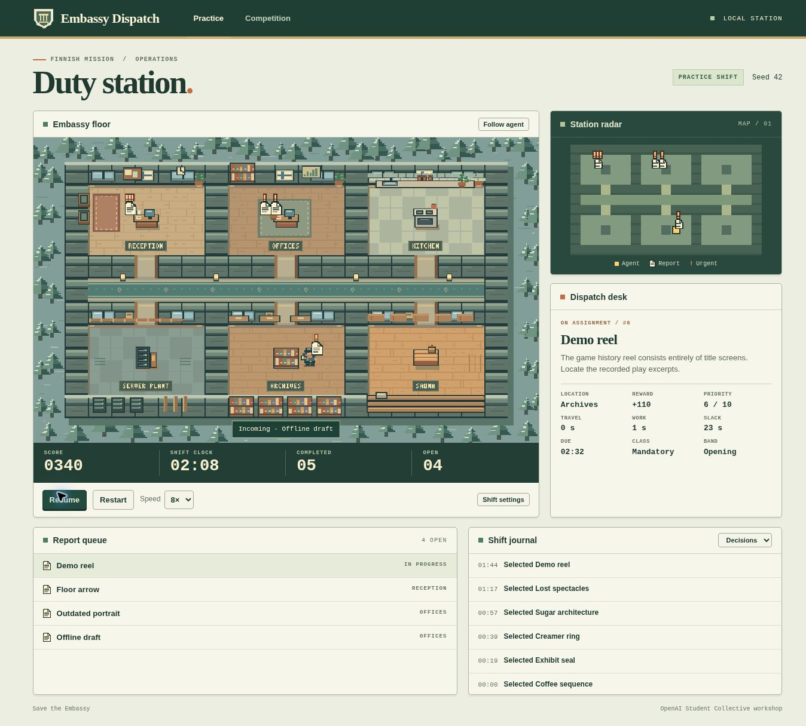

# Save the Finnish Embassy

Give a Python agent six simulated minutes to keep a fictional Finnish embassy open. It can rescue the coffee service, investigate a wandering paperweight, or cross the entire building for a report that expires on arrival. Every walk and every second of work counts. A missed mandatory report closes the shift.



## Get ready for the workshop

You'll need Git to download your fork, Node.js and npm to launch the game, Python 3.11 or newer to run your agent, and VS Code for editing it. The first install needs internet. Practice runs locally with the Python standard library.

### Windows 10 or 11

Open **PowerShell** from Start. Run these lines individually. If Windows cannot find `winget`, install or update **App Installer** from the Microsoft Store and reopen PowerShell.

```powershell
winget install -e --id Git.Git
winget install -e --id Python.Python.3.12
winget install -e --id OpenJS.NodeJS.LTS
winget install -e --id Microsoft.VisualStudioCode
```

Close PowerShell, open a new window and check:

```powershell
git --version
python --version
node --version
npm.cmd --version
code --version
```

Use `npm.cmd` anywhere this guide says `npm` if PowerShell blocks npm.ps1. You can run the entire workshop in native Windows.

### macOS, Apple Silicon or Intel

Open **Terminal**. If you already have Homebrew, skip its installer. Otherwise run:

```sh
/bin/bash -c "$(curl -fsSL https://raw.githubusercontent.com/Homebrew/install/HEAD/install.sh)"
```

Run the line for your Mac. **Apple menu → About This Mac** shows either an Apple chip or an Intel processor.

| Mac | Terminal command |
| --- | --- |
| Apple Silicon | `eval "$(/opt/homebrew/bin/brew shellenv)"` |
| Intel | `eval "$(/usr/local/bin/brew shellenv)"` |

Follow the installer's **Next steps** to keep Homebrew available in new terminals. Then run:

```sh
brew install git python node@24
brew install --cask visual-studio-code
echo 'export PATH="$(brew --prefix node@24)/bin:$PATH"' >> ~/.zprofile
export PATH="$(brew --prefix node@24)/bin:$PATH"
git --version
python3 --version
node --version
npm --version
code --version
```

If `code` is missing, open VS Code from Applications, press **Cmd+Shift+P**, run **Shell Command: Install 'code' command in PATH**, then open a new Terminal.

### Ubuntu or Debian

Open **Terminal**. These commands select the VS Code package for your processor.

```sh
sudo apt update
sudo apt install -y git python3 curl ca-certificates
curl -fL "https://update.code.visualstudio.com/latest/linux-deb-$(dpkg --print-architecture | sed 's/^amd64$/x64/')/stable" -o /tmp/embassy-code.deb
sudo apt install -y /tmp/embassy-code.deb
```

Continue with **Node.js on Linux** below.

### Fedora

Open **Terminal** and run:

```sh
sudo dnf install -y git python3
command -v curl || sudo dnf install -y curl
case "$(uname -m)" in x86_64) code_arch=x64 ;; aarch64) code_arch=arm64 ;; esac
curl -fL "https://update.code.visualstudio.com/latest/linux-rpm-${code_arch}/stable" -o /tmp/embassy-code.rpm
sudo dnf install -y /tmp/embassy-code.rpm
```

### Node.js on Linux

For both Linux families, install the workshop version in your own account and check your tools:

```sh
curl -fsSL https://raw.githubusercontent.com/nvm-sh/nvm/v0.40.7/install.sh | bash
export NVM_DIR="$HOME/.nvm"
. "$NVM_DIR/nvm.sh"
nvm install 24
nvm alias default 24
git --version
python3 --version
node --version
npm --version
code --version
```

If your distribution ships Python below 3.11, install a separate interpreter with [uv](https://docs.astral.sh/uv/getting-started/installation/) and select it for the workshop:

```sh
curl -LsSf https://astral.sh/uv/install.sh | sh
"$HOME/.local/bin/uv" python install 3.12
export EMBASSY_PYTHON="$("$HOME/.local/bin/uv" python find 3.12)"
```

## Fork, open and play

1. Sign in to GitHub. Open [Coshea46/save-the-embassy](https://github.com/Coshea46/save-the-embassy), choose **Fork → Create fork**, then open **Code → HTTPS** on your fork and copy the URL.
2. In PowerShell or Terminal, type `git clone`, add a space, paste that URL, and press Enter. Then run:

   ```sh
   cd save-the-embassy
   code --install-extension openai.chatgpt
   code --list-extensions
   code .
   ```

3. In VS Code, open **Codex** in the sidebar and choose **Sign in with ChatGPT**. Check that the installed extension is **Codex** from **OpenAI**. The game itself can run independently of this sign-in.
4. In VS Code choose **Terminal → New Terminal**. From the folder containing the root `package.json`, run:

   ```sh
   npm ci
   npm run doctor
   npm start
   ```

5. Open **http://127.0.0.1:4173** in your browser, or the address printed by the launcher. Select **Run agent**. Click a document on the floor, radar or queue to inspect its deadline and travel cost. Select **Follow agent** for a closer view.
6. Open [apps/game/python/agent.py](apps/game/python/agent.py). Ask Codex to change its scheduling rule, save the file, then click **Restart → Run agent**. Restart creates a fresh Python process and reuses the seed. **Shift settings** accepts a chosen seed or a blank field for a random one.
7. Use **Shift journal → History** to see what completed or expired. Compare the score and survival clock on the same seed. The [workshop guide](docs/WORKSHOP.md) includes prompts and a faster multi-seed experiment.
8. To enter an official round, open the organiser’s invitation, register your player name, then select **Copy game credentials**. In the local game choose **Competition → Joined on the website**, paste and select **Join or resume → Run agent**. Follow [Join an official shift](docs/WORKSHOP.md#join-an-official-shift). **Competition → Local rehearsal** exercises this flow offline and earns an unranked score.

Stop the launcher with **Ctrl+C** in the terminal. Return to this folder and run **npm start** next time.

## Troubleshooting

| What you see | What to do |
| --- | --- |
| `package.json` missing or `Missing script: start` | Open the cloned repository folder in VS Code. Check that its top level contains `apps`, `packages` and `package.json`. |
| `node`, `git`, `code` or `python` is unrecognised | Reopen VS Code and its terminal after installation. Run the version checks for your OS. On Linux/macOS use `python3`. |
| Python opens the Microsoft Store | Run `py -3.12 --version`, then `$env:EMBASSY_PYTHON = (py -3.12 -c "import sys; print(sys.executable)")` in the same terminal before launch. |
| Syntax error, missing module or agent timeout | The shift pauses. Read the error and the launcher terminal, correct the file, and choose **Reload agent → Resume**. Reload resets class memory. For a comparable practice run, choose **Restart**. |
| Third-party Python dependency missing | Ordinary play needs none. If you deliberately added one, install it into the same interpreter named by `npm run doctor`. |
| Port already in use | Stop the other launcher, or set `$env:EMBASSY_PORT="4174"` in PowerShell or `export EMBASSY_PORT=4174` on macOS/Linux, then relaunch and open the printed URL. |
| Browser refuses a launch request | Open the exact printed `127.0.0.1` address. Reload the tab after restarting Node. |
| Official workshop is greyed out | Choose **Joined on the website** and paste the credentials from your invitation. The **Official workshop** option also works when the launcher has the organiser’s API URL. |

[Integration results and screenshots](docs/INTEGRATION.md) · [Organiser deployment and environment variables](docs/PLATFORM.md) · [Simulation rules](docs/SIMULATION.md) · [Architecture](docs/ARCHITECTURE.md) · [REST contracts](docs/API.md) · [Catalogue audit](apps/game/qa/catalogue-audit.json) · [MIT licence](LICENSE)

Installation references: [VS Code for Linux](https://code.visualstudio.com/docs/setup/linux), [Homebrew](https://brew.sh), [Node.js](https://nodejs.org/en/download), [WinGet](https://learn.microsoft.com/windows/package-manager/winget/install), [Codex extension](https://marketplace.visualstudio.com/items?itemName=openai.chatgpt).
